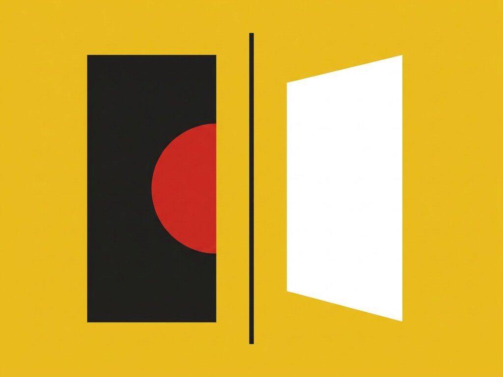

# Exp. 002 · Flip cards

Flip cards that reveal different information on each side. Pure CSS, responsive.

- Live demo and notes: https://dexitheus.ai/experimentos/002-cara-oculta/
- CodePen: https://codepen.io/dexitheus/pen/OPprdLN
- Category: CSS effects

Open `index.html` in a browser. Files: index.html, style.css, plus the shared [`base.css`](../base.css) one folder up.
