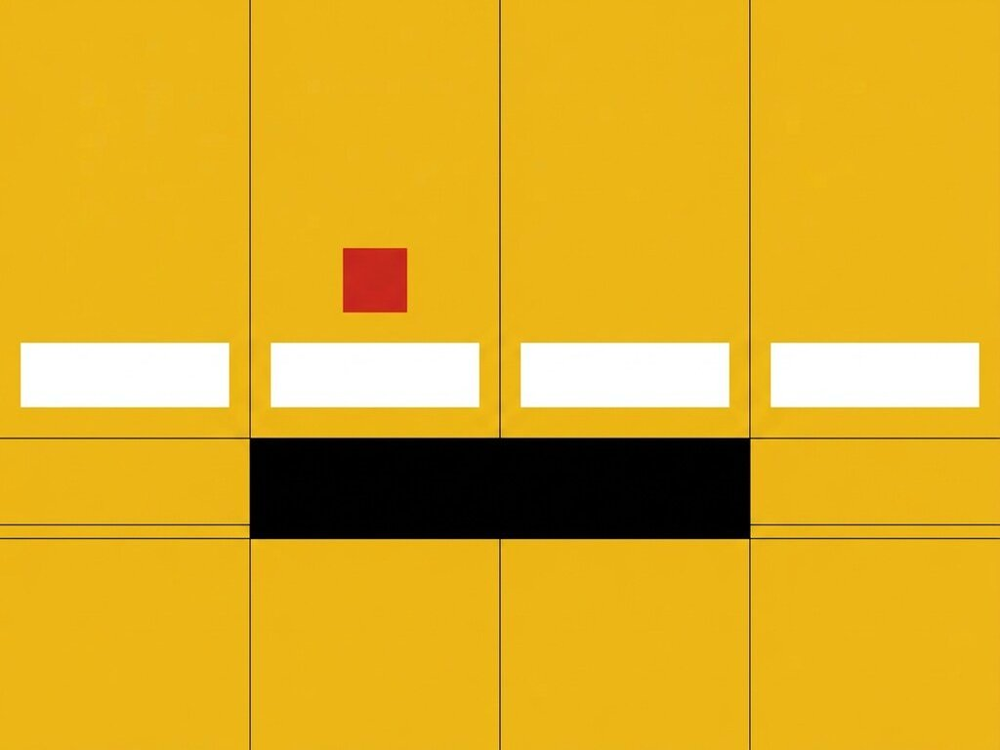

# Exp. 004 · Fluid tabs

Tab bar with a fluid indicator that stretches to the new tab and shrinks into place. Vanilla JS, no dependencies.

Inspired by [Tabs](https://dribbble.com/shots/2561589-Tabs) on Dribbble.

- Live demo and notes: https://dexitheus.ai/experimentos/004-fluid-tabs/
- CodePen: https://codepen.io/dexitheus/pen/JZzdgb
- Category: Components

Open `index.html` in a browser. Files: index.html, style.css, script.js, plus the shared [`base.css`](../base.css) one folder up.
