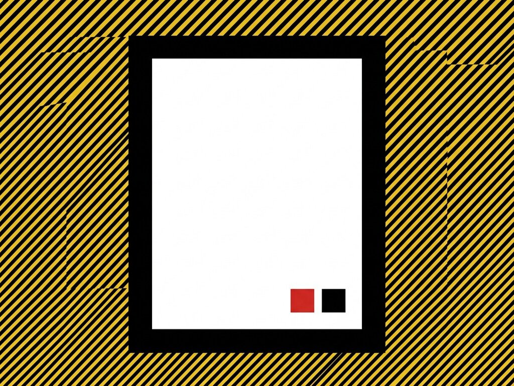

# Exp. 005 · Blur dialog

Confirmation dialog on the native `<dialog>` element. The page behind blurs while it is open. Opens with the button or the X key; closes with Esc or a click outside.

- Live demo and notes: https://dexitheus.ai/experimentos/005-blur-dialog/
- CodePen: https://codepen.io/dexitheus/pen/PwqwJdP
- Category: Components

Open `index.html` in a browser. Files: index.html, style.css, script.js, plus the shared [`base.css`](../base.css) one folder up.
