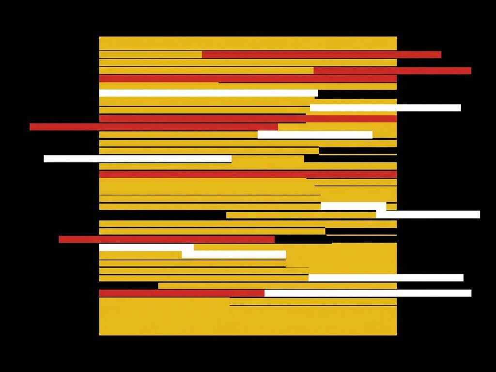

# Exp. 009 · The Glitch

A dark showcase of CSS effects: a glitch headline, a drifting aurora, a text scramble and a canvas spotlight that follows the cursor. No libraries, no frameworks.

- Live demo and notes: https://dexitheus.ai/experimentos/009-the-glitch/
- CodePen: https://codepen.io/dexitheus/pen/xbggpLK
- Category: CSS effects

Open `index.html` in a browser. Files: index.html, style.css, script.js, plus the shared [`base.css`](../base.css) one folder up.
