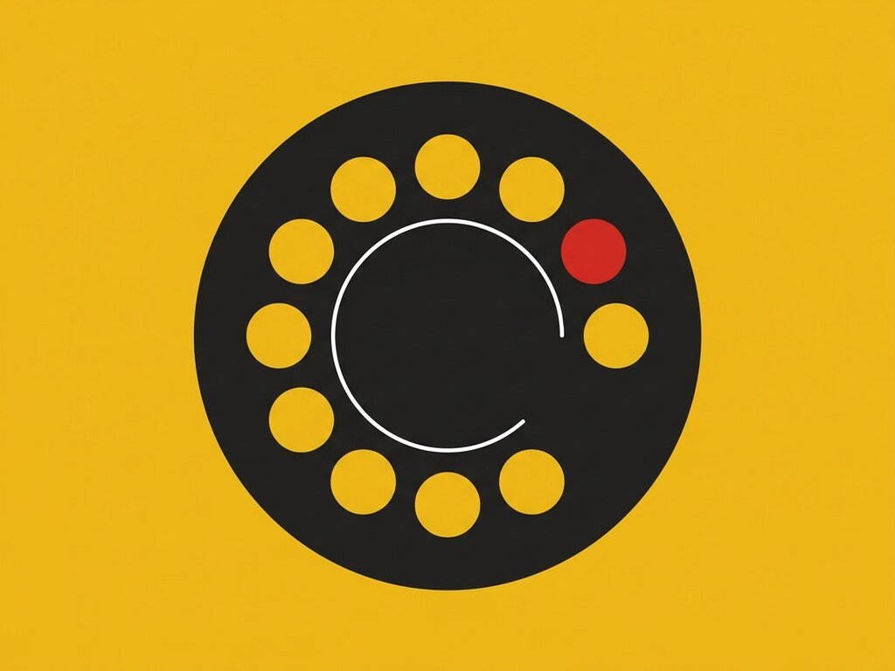

# Exp. 010 · Dial buttons

Circular dial buttons that fan out their options, driven by CSS `cos()` and `sin()`.

- Live demo and notes: https://dexitheus.ai/experimentos/010-dial-buttons/
- CodePen: https://codepen.io/dexitheus/pen/MYaoVgP
- Category: Components

Open `index.html` in a browser. Files: index.html, style.css, script.js, plus the shared [`base.css`](../base.css) one folder up.
