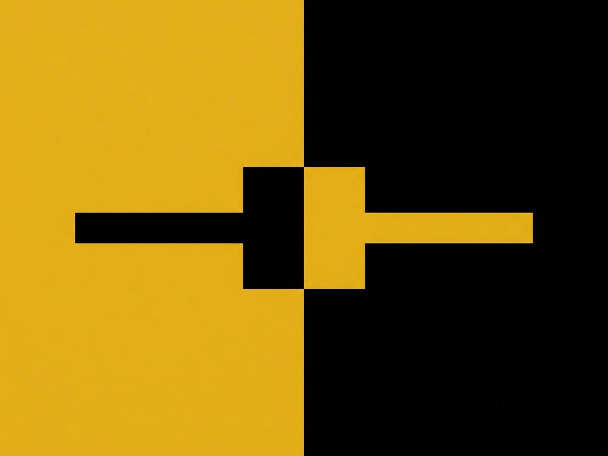

# Exp. 013 · Toggle switch

A square toggle switch that flips the whole page into dark mode. Pure CSS with `:has()`, no JavaScript. Keyboard accessible and announced as a switch.

- Live demo and notes: https://dexitheus.ai/experimentos/013-toggle-switch/
- CodePen: https://codepen.io/dexitheus/pen/RwMMYPo
- Category: Components

Open `index.html` in a browser. Files: index.html, style.css, plus the shared [`base.css`](../base.css) one folder up.
