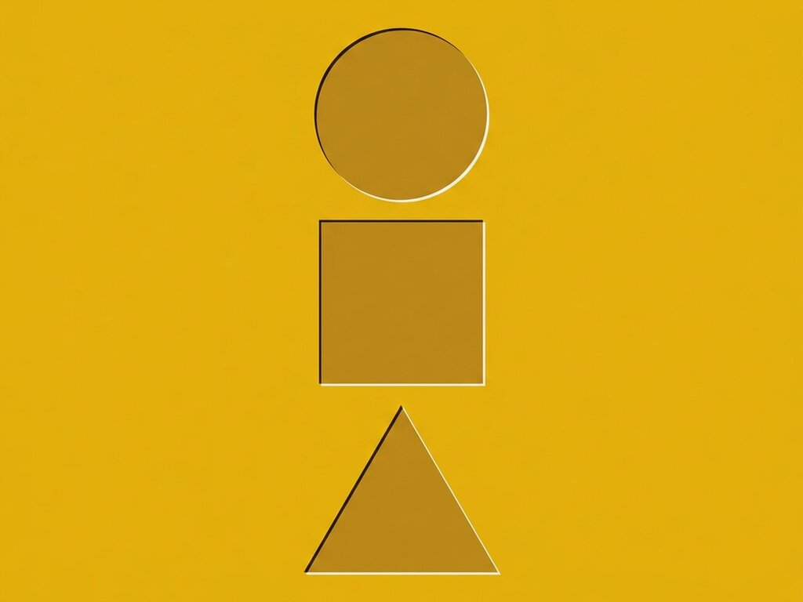

# Exp. 014 · Inner shadow

Pressed-in text made with a Sass mixin: one colour in, a carved letterpress effect out, built from layered text-shadows.

Inspired by [webbaron's pen](https://codepen.io/webbaron/pen/ifzjl).

- Live demo and notes: https://dexitheus.ai/experimentos/014-inner-shadow/
- CodePen: https://codepen.io/dexitheus/pen/VwGzpXz
- Category: CSS effects

Open `index.html` in a browser. Files: index.html, style.scss, style.css, plus the shared [`base.css`](../base.css) one folder up.

`style.css` is compiled from `style.scss`; edit the Sass file and recompile.
