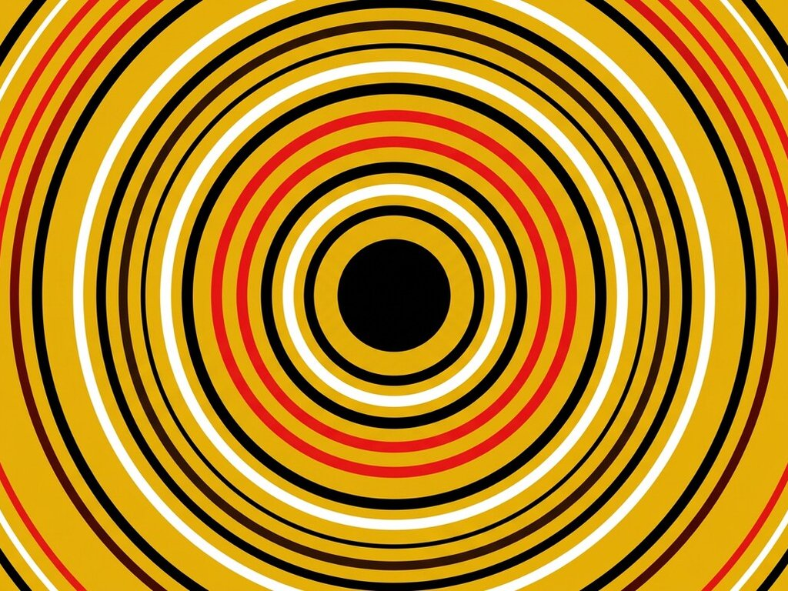

# Exp. 016 · Pulse button

A circular button that sends out a wave on every click: the ring springs on hover and press, and each wave fades out as it expands. Vanilla JS, keyboard friendly.

- Live demo and notes: https://dexitheus.ai/experimentos/016-pulse-button/
- CodePen: https://codepen.io/dexitheus/pen/dPYRKZB
- Category: Components

Open `index.html` in a browser. Files: index.html, style.css, script.js, plus the shared [`base.css`](../base.css) one folder up.
