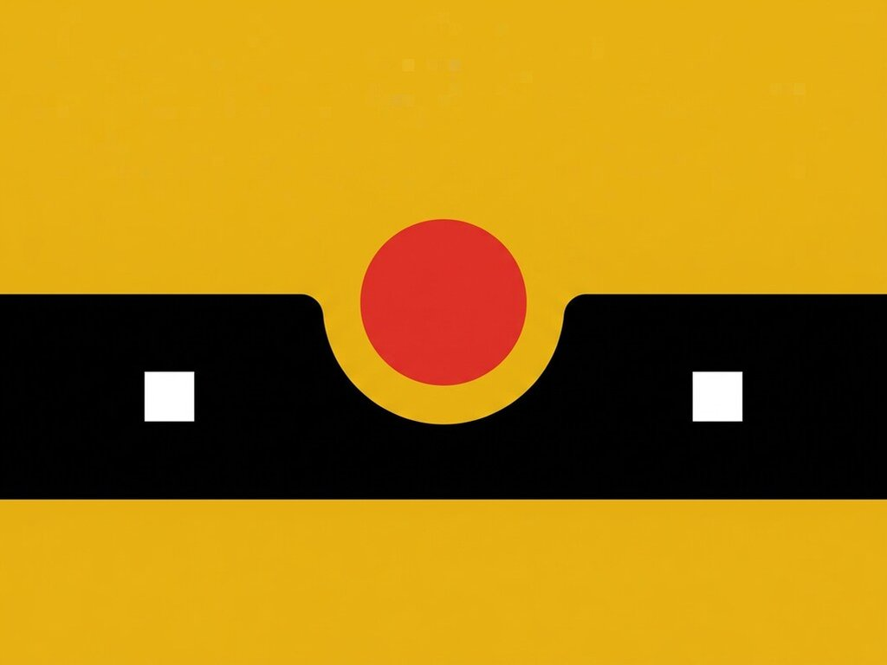

# Exp. 018 · Gooey tab bar

A gooey mobile tab bar in pure CSS: blur + contrast melt the bar and a blob into one liquid notch that follows the selected tab, while the active icon jumps into the floating circle. Works with the keyboard.

- Live demo and notes: https://dexitheus.ai/experimentos/018-gooey-tab-bar/
- CodePen: https://codepen.io/dexitheus/pen/raVaGrd
- Category: Components

Open `index.html` in a browser. Files: index.html, style.css, plus the shared [`base.css`](../base.css) one folder up.
