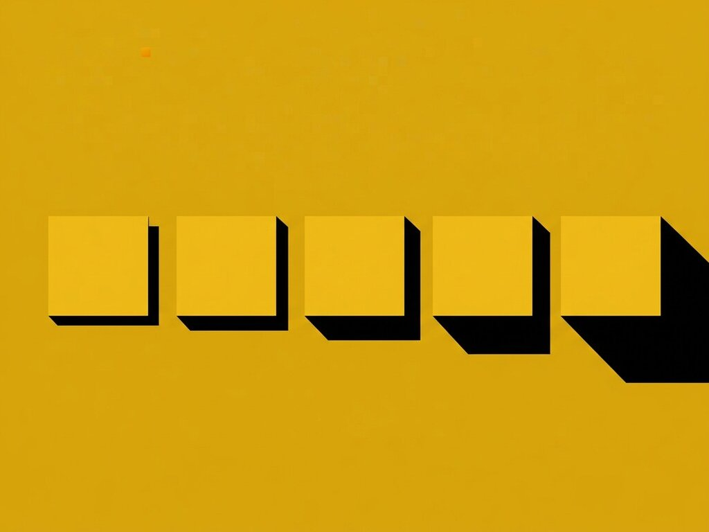

# Exp. 020 · Elevation

Five elevation levels adapted from Material Design's shadows, tinted from the page colour instead of grey, so depth reads on mustard. Each level is two layered shadows: a wide soft one and a tight contact one.

- Live demo and notes: https://dexitheus.ai/experimentos/020-elevation/
- CodePen: https://codepen.io/dexitheus/pen/mKoeJx
- Category: CSS effects

Open `index.html` in a browser. Files: index.html, style.css, plus the shared [`base.css`](../base.css) one folder up.
